<div align="center">

# AutoForge

**Design the car you want, part by part.**
A design-your-own-car studio: pick a body style, shape every part, and watch each change happen live in 3D with the price in your local currency.

[**Live site**](https://autoforge-phi.vercel.app) · [**Case study: the design blueprint**](https://autoforge-phi.vercel.app/blueprint) · [Source](https://github.com/amit429/AUTOFORGE)

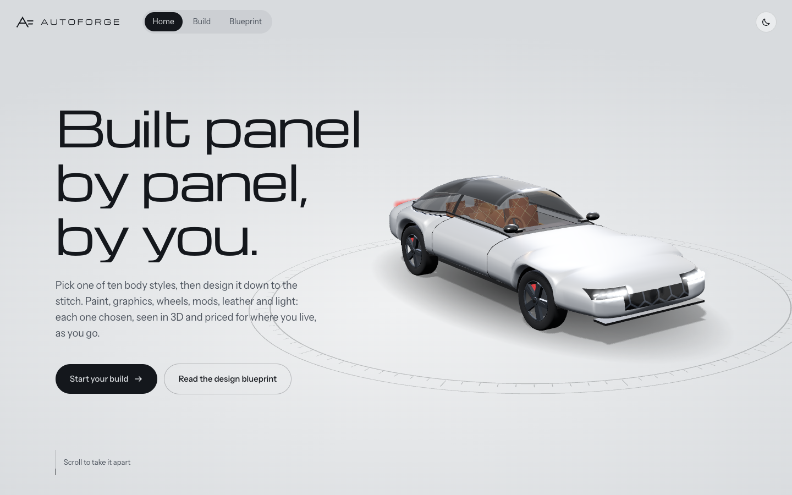

</div>

---

## Why this exists

Most car configurators let you pick a trim, a paint and some wheels on one brand's cars. AutoForge asks what happens if you design a car the way a custom builder would: choose the shape, then every visible part, inside and out, one at a time.

Brand configurators have problems that this project sets out to fix:

| Problem with typical configurators | What AutoForge does |
|---|---|
| Choice is flattened into packages | Ten body styles and 14 steps of part-level choices |
| Pre-rendered images are slow and fixed-angle | Real-time 3D with a directed camera |
| Price appears only on the last page | Live price on every option, in the region's currency |
| "Not available" with no explanation | Every locked option says why, in one sentence |
| Region hidden in a footer dropdown | Region is the first decision; changing it swaps invalid options and explains each swap |
| Interior seen from one angle | Cabin view lifts the roof so seats, trim and light show together |

The full reasoning (research, personas, experience principles, user flow, engine and motion design) is written up in the **[case study page](https://autoforge-phi.vercel.app/blueprint)**, which is part of the app itself.

> The research there is desk research and a heuristic review of existing configurators. The personas are proto-personas, and the page includes a validation study plan rather than results from real user testing.

## Screenshots

### Pick a region first
Region sets drive side, currency, legal limits and regional exclusives. It's suggested from the device time zone.

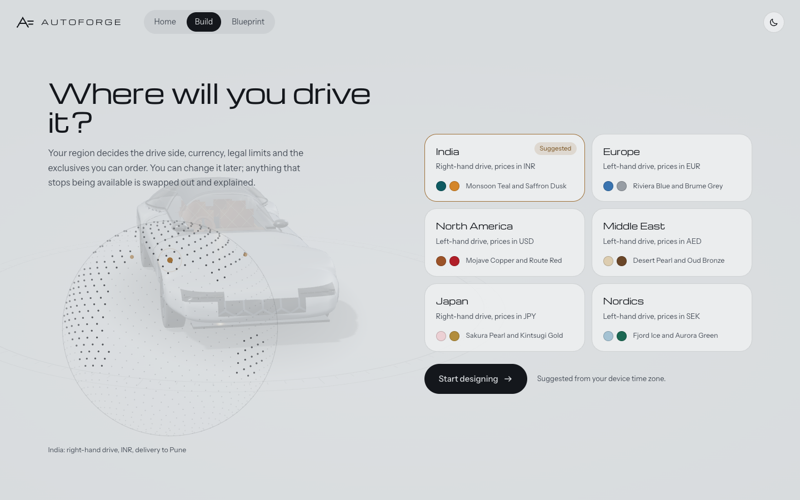

### Take it apart
The landing page is a scroll story that drives the 3D camera, ending in an exploded component view.

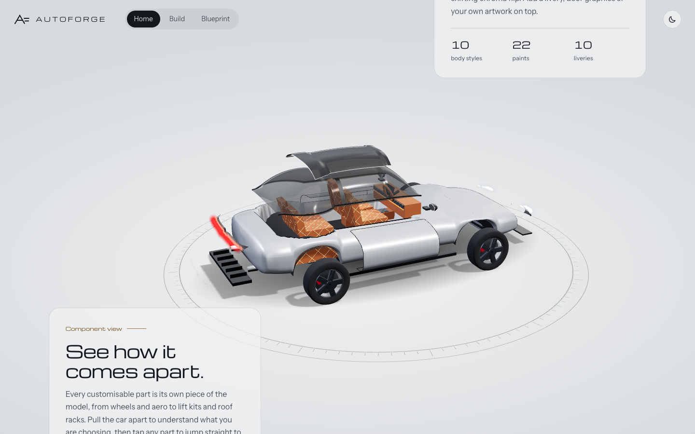

### The studio

| Body style | Paint |
|---|---|
| 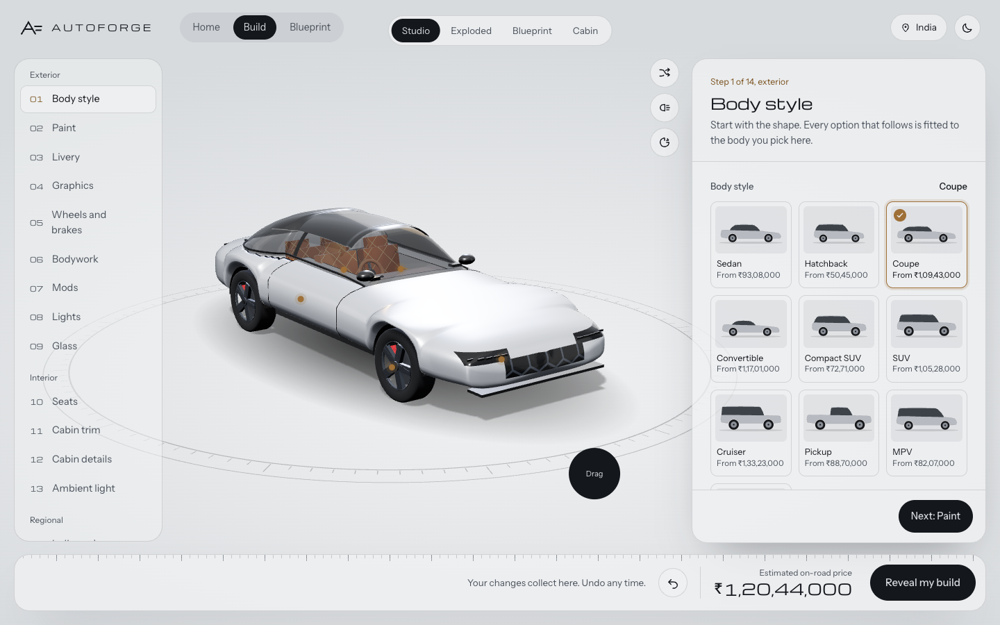 | 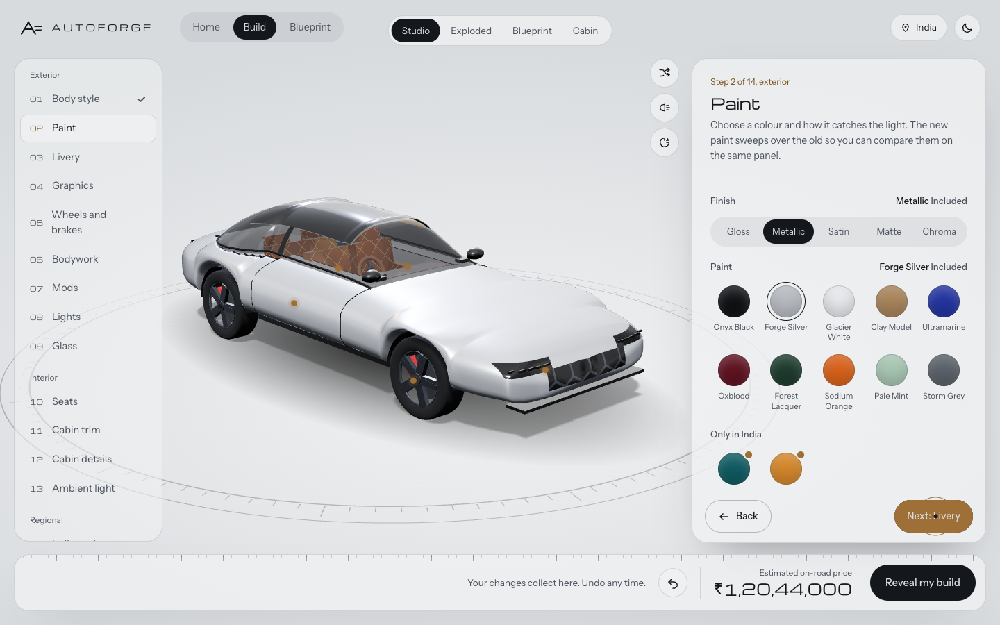 |
| **Livery** | **Graphics** |
| 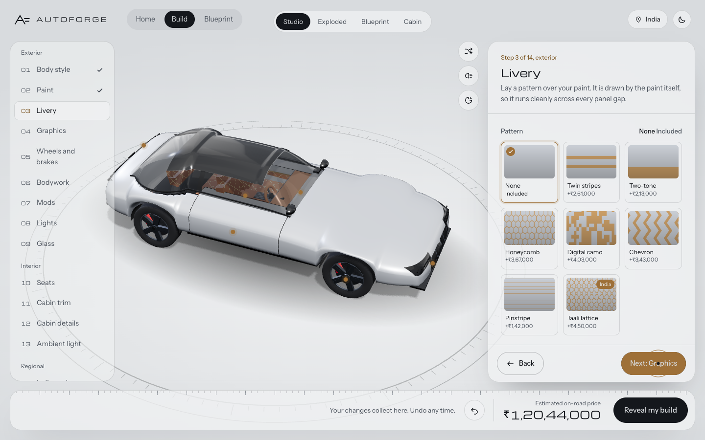 | 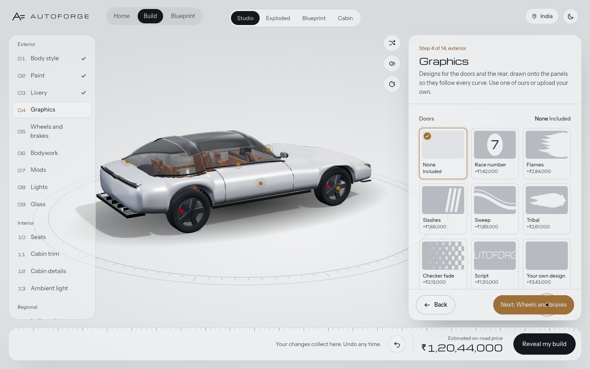 |

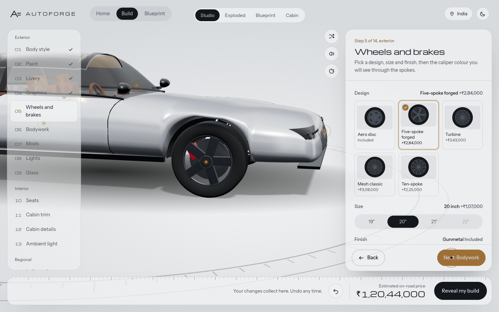

Paint, livery and trim changes are shader sweeps, not swaps, so you can compare old and new on the same panel. Wheels spin-swap, and the camera moves to wherever the part you're editing lives.

### The reveal
The finished design gets a design ID, an itemised spec and a copyable link.

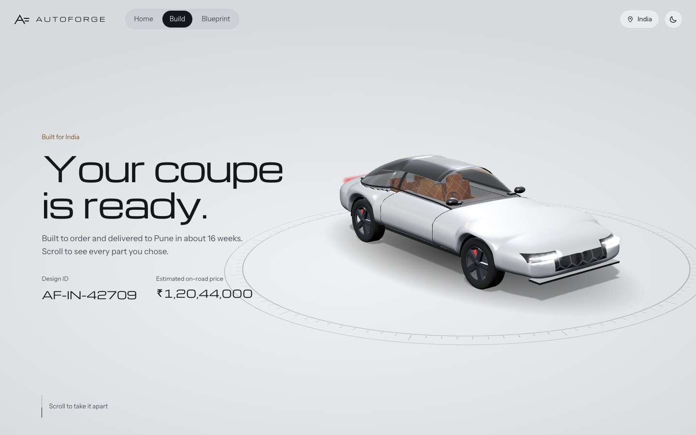

### The case study page
Research, principles, flows, part taxonomy, engine, pipeline, design and motion systems, all in one document.

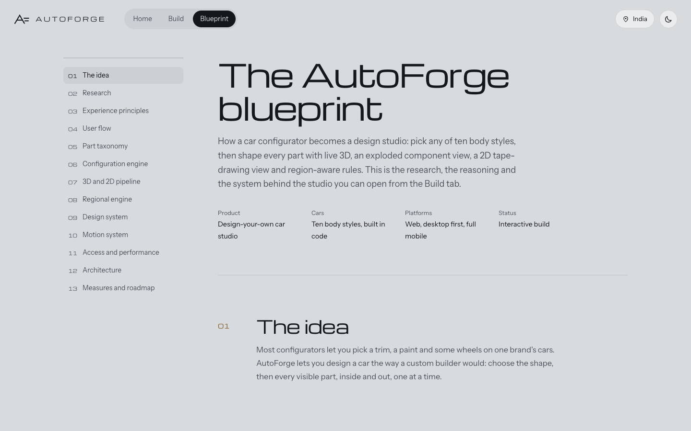

### On mobile
The step spine becomes a horizontal strip and the options panel becomes a bottom sheet.

<p align="center">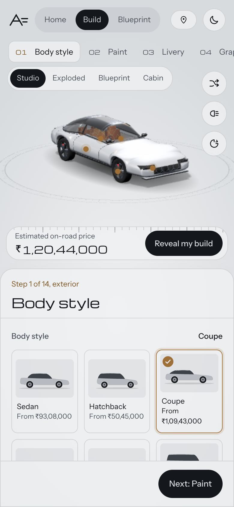</p>

## Features

- **Ten body styles:** sedan, hatchback, coupe, convertible, compact SUV, SUV, cruiser, pickup, MPV, supercar.
- **14 steps:** body style, paint, livery, graphics, wheels and brakes, bodywork, mods, lights, glass, seats, cabin trim, cabin details, ambient light, regional pack.
- **Four views:** Studio, Exploded, Blueprint (2D elevation and plan) and Cabin.
- **Six regions:** India, Europe, North America, Middle East, Japan, Nordics, each with its own currency, drive side, legal limits and exclusive options.
- **Rules engine:** availability, reasons, pricing and region swaps are computed by pure functions; the UI only renders them.
- **History and undo:** single changes and grouped snapshots, also on Ctrl/Cmd+Z.
- **Shareable builds:** the whole build lives in `?b=`, so any link is shareable and resumable. Builds autosave to localStorage.
- **Accessibility:** keyboard reachable, locked options stay focusable and explain themselves, price changes are announced, and reduced motion is respected everywhere.

## Tech stack

| Area | Choice |
|---|---|
| Framework | Next.js (App Router), React, TypeScript (strict) |
| 3D | React Three Fiber, drei, three.js, with a custom paint shader (sweep transition and 17 patterns) |
| Motion | Motion (`motion/react`) for UI, GSAP and ScrollTrigger for the scroll story and camera timelines |
| State | Zustand; the engine is pure TypeScript outside React |
| Styling | CSS variables from the design tokens, plus CSS modules |
| Testing | Vitest (engine and store), Playwright with axe (flows and accessibility on desktop, mobile and reduced motion) |
| Hosting | Vercel |

## Getting started

```bash
pnpm install
pnpm dev          # http://localhost:3000
pnpm build        # production build (every route prerenders statically)
pnpm test         # Vitest: rules engine and store
pnpm e2e          # Playwright: flow + accessibility, desktop, mobile, reduced motion
pnpm lint && pnpm typecheck
```

`pnpm e2e` builds and serves on port 3100. To run it against a dev server you already have running, set `E2E_URL=http://localhost:3000`.

## Routes

| Route | Screen |
|---|---|
| `/` | Loader, hero, six-chapter scroll story that drives the 3D camera |
| `/region` | Region picker with globe, suggested from the time zone |
| `/build/[step]?b=` | Studio: 14 steps, 4 views, live price, history and undo |
| `/reveal?b=` | Scroll-through reveal of the finished design, itemised spec, design ID, copyable link |
| `/blueprint` | The case study document (the 3D stage stops rendering here) |

## Architecture

- `src/engine/`: pure TypeScript rules engine. Handles availability with reasons, pricing and per-currency rounding, region swaps, undo history and build codes. The UI never decides what is valid.
- `src/store/`: Zustand stores. `build.ts` holds the build, history, step and view; `ui.ts` holds screen-level state; `toasts.ts` holds notifications.
- `src/three/`: the 3D layer. `car/CarModel.ts` is the placeholder car, built to the node contract in `docs/3D_PIPELINE.md`. `materials/paint.ts` is the paint shader, `camera.ts` the directed camera rig, and `director.ts` turns store changes into transitions.
- `src/components/`: React UI. Step panels are in `steps/`, and the configurator shell and controls are in `config/`.
- `data/options.json`: every option, price, region and rule.

Design decisions behind these are in the [case study](https://autoforge-phi.vercel.app/blueprint) and in `docs/` (`PRD.md`, `DESIGN_SYSTEM.md`, `3D_PIPELINE.md`, `IMPLEMENTATION_PLAN.md`).

## Project history

The original handoff spec (`docs/`, `data/options.json`, `reference/prototype.html`) was written for a single fictional model. The product has since been generalised into AutoForge, a studio rather than a single-model site. `reference/prototype.html` remains the behavioural source of truth.

## Not done yet

- **Real car model:** the car is a procedural placeholder. A licensed glTF can be swapped in behind `CarModel`, keeping the node names in `docs/3D_PIPELINE.md`; no UI code should need to change.
- **User validation:** the study plan in the case study hasn't been run.
